  
  
  

## About

I'm a software engineer at **Cogveel Technologies** in Srinagar. For the past two years I've built websites and web apps for clients, mainly with **React, Next.js and TypeScript**, and backends with **Node.js and MongoDB** when a project needs one.

- **Now:** building client products at Cogveel (since Jun 2024)
- **On the side:** OneTap Cricket, a live ball-by-ball cricket scoring app
- **Next:** a frontend or full-stack role on a product team

## Tech

  <picture><source media="(prefers-color-scheme: dark)" srcset="https://skillicons.dev/icons?i=react&theme=dark"></picture>
  <picture><source media="(prefers-color-scheme: dark)" srcset="https://skillicons.dev/icons?i=nextjs&theme=dark"></picture>
  <picture><source media="(prefers-color-scheme: dark)" srcset="https://skillicons.dev/icons?i=ts&theme=dark"></picture>
  <picture><source media="(prefers-color-scheme: dark)" srcset="https://skillicons.dev/icons?i=js&theme=dark"></picture>
  <picture><source media="(prefers-color-scheme: dark)" srcset="https://skillicons.dev/icons?i=redux&theme=dark"></picture>
  <picture><source media="(prefers-color-scheme: dark)" srcset="https://skillicons.dev/icons?i=tailwind&theme=dark"></picture>
  <picture><source media="(prefers-color-scheme: dark)" srcset="https://skillicons.dev/icons?i=nodejs&theme=dark"></picture>
  <picture><source media="(prefers-color-scheme: dark)" srcset="https://skillicons.dev/icons?i=express&theme=dark"></picture>
  <picture><source media="(prefers-color-scheme: dark)" srcset="https://skillicons.dev/icons?i=nestjs&theme=dark"></picture>
  <picture><source media="(prefers-color-scheme: dark)" srcset="https://skillicons.dev/icons?i=mongodb&theme=dark"></picture>
  <picture><source media="(prefers-color-scheme: dark)" srcset="https://skillicons.dev/icons?i=postgres&theme=dark"></picture>
  <picture><source media="(prefers-color-scheme: dark)" srcset="https://skillicons.dev/icons?i=redis&theme=dark"></picture>
  <picture><source media="(prefers-color-scheme: dark)" srcset="https://skillicons.dev/icons?i=docker&theme=dark"></picture>
  <picture><source media="(prefers-color-scheme: dark)" srcset="https://skillicons.dev/icons?i=aws&theme=dark"></picture>
  <picture><source media="(prefers-color-scheme: dark)" srcset="https://skillicons.dev/icons?i=git&theme=dark"></picture>

## Selected work

| Project | What I did | Stack |
|:---|:---|:---|
| **Kashmir Travel Desk** | Built the entire frontend of a travel booking platform on my own: traveller, agency and admin views. | Next.js · TypeScript · Tailwind |
| **PathGrad** | Built a study-abroad website and admin panel alone, from the database to the UI. | React · Node.js · Express · MongoDB |
| **Koshme** | Co-built the shop and admin panel of an online store for handwoven Kashmiri Pashmina. | React · TypeScript · Redux Toolkit |
| **JKAloha** | Built the admin screens of a school management system for an institute with several branches. | React · TypeScript · Redux Toolkit |
| **InnovatiCS** | Built most of the admin panel of a training company's site in English, French and Arabic. | React · Node.js · MongoDB |
| **OneTap Cricket** | My side project: a mobile app for live, ball-by-ball cricket scoring. | React Native · NestJS · PostgreSQL · Redis |
| [**all-country-flags**](https://github.com/daraasif/all-country-flags) | Open source: every country flag as an SVG, named by ISO code. | SVG |

Most of these are client projects, so their code is private.

## Activity

<picture>
  <source media="(prefers-color-scheme: dark)" srcset="https://raw.githubusercontent.com/daraasif/daraasif/output/snake-dark.svg">
  
</picture>
