<!-- Animated Banner -->
<picture>
  <source media="(prefers-color-scheme: dark)" srcset="./aasif-banner.svg">
  <source media="(prefers-color-scheme: light)" srcset="./aasif-banner.svg">
  
</picture>

 

<table align="center" border="0">
<tr>
<td width="38%" align="center" valign="middle">

<!-- Swinging Lanyard ID Card -->

</td>
<td width="62%" valign="middle">

### About me

Software Engineer at **Cogveel Technologies**, Srinagar. For the past two years I have built websites and web apps for clients, mainly with **React, Next.js and TypeScript**, and backends with **Node.js and MongoDB**.

Open to frontend and full-stack roles.

### Tech stack

**Frontend:** React · Next.js · TypeScript · JavaScript · Redux Toolkit · Tailwind CSS 
**Backend:** Node.js · Express · NestJS · REST APIs · WebSockets 
**Databases:** MongoDB · PostgreSQL · MySQL · Redis 
**Tools:** Git · Docker · AWS S3 · Postman

</td>
</tr>
</table>

 

### Projects

| Project | What it is | Tech |
|:---|:---|:---|
| **Kashmir Travel Desk** | Travel booking platform. Built the entire frontend on my own. | `Next.js` `TypeScript` `Tailwind CSS` |
| **PathGrad** | Study-abroad website and admin panel. Built alone, from database to UI. | `React` `Node.js` `Express` `MongoDB` |
| **Koshme** | Online store for handwoven Kashmiri Pashmina. | `React` `TypeScript` `Redux Toolkit` |
| **JKAloha** | School management system for an institute with several branches. | `React` `TypeScript` `Redux Toolkit` |
| **InnovatiCS** | Training company website in English, French and Arabic. | `React` `Node.js` `MongoDB` |
| **OneTap Cricket** *(side project)* | Mobile app for live, ball-by-ball cricket scoring. | `React Native` `NestJS` `PostgreSQL` `Redis` |
| [**all-country-flags**](https://github.com/daraasif/all-country-flags) *(open source)* | Every country flag as an SVG, named by ISO code. | `SVG` |

Most of these are client projects, so their code is private.

 

### GitHub Stats and Graphs

  

<!-- Activity Graph -->

  

<!-- Trophies (local animated SVG, always loads) -->

  

### Watch the snake eat my contributions

<picture>
  <source media="(prefers-color-scheme: dark)" srcset="https://raw.githubusercontent.com/daraasif/daraasif/output/github-contribution-grid-snake-dark.svg">
  <source media="(prefers-color-scheme: light)" srcset="https://raw.githubusercontent.com/daraasif/daraasif/output/github-contribution-grid-snake.svg">
  
</picture>

  

### Let's Connect

  

  

*Always learning, always building.* 🚀

